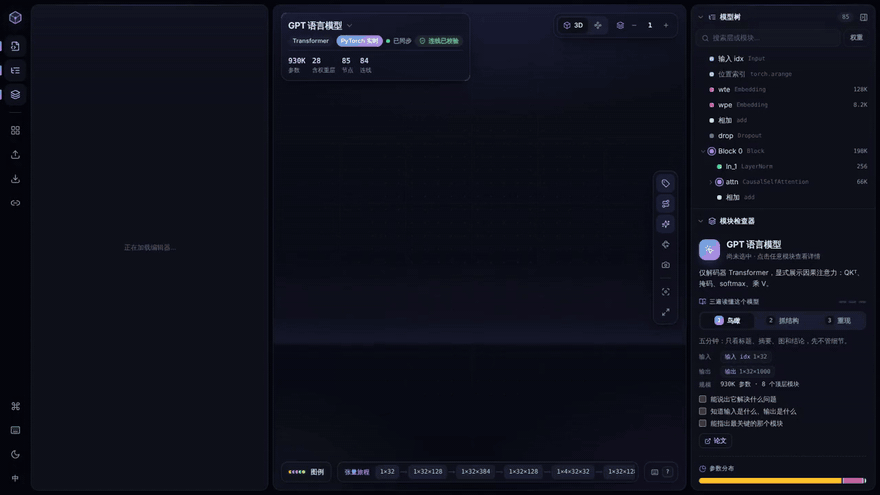

# Model Atlas · 3D model architecture lab

**English** | [简体中文](README.zh-CN.md)

**Write PyTorch code in the browser and watch its 3D architecture update live.** Change one line (number of layers, channels, strides, attention heads…) and the 3D structure, tensor shapes and parameter counts are rebuilt immediately; if the code is wrong, the offending line is pointed out. The interface is available in English and Chinese.



Demo video (43 s, MP4): [docs/media/demo.mp4](docs/media/demo.mp4)

**Runs entirely on your machine.** The 3D view is produced by a small Python interpreter that ships inside the page. It only infers tensor shapes and does no real computation, so there is no network access, no API key, no Python or PyTorch to install, and your code is never uploaded. Projects and notes live only in your own browser, and you can export them to a file.

## Run

```bash
npm install      # first run only
npm run dev
```

Open the address printed in the terminal (http://127.0.0.1:5173 by default). On Windows you can also double-click `start-3d-model.bat`, which runs `npm install` on first use. Requires Node.js 22.6 or newer (the current 22 LTS is recommended).

| Command | What it does |
| --- | --- |
| `npm run build` | Type check and production build |
| `npm test` | Run all four test suites below |
| `npm run test:interpreter` | Interpreter tests: 38 common PyTorch idioms, parameter counts and printed output checked against real PyTorch |
| `npm run test:training` | Training-loop tracing and import template tests |
| `npm run test:study` / `npm run test:gestures` | Study tools and gesture state machine tests |
| `npm run check:graphs` | Check every built-in model for broken ports, shapes, overlaps and lines through blocks |
| `npm run trace -- model.py train.py` | Trace a set of files from the command line and print run order, top-level modules, shapes and parameter counts |
| `npm run verify:torch` | Optional: with PyTorch installed, check every built-in model and interpreter test against real PyTorch (see below) |

## Interface

- **Left: code.** `model.py` is real PyTorch code. The **Experiments** buttons above it edit the code for you (for example, make GPT 8 layers deep or give U-Net an odd input size) so you can see how the structure changes or breaks. The **Summary** tab is a torchinfo-style per-layer table. Placing the cursor on a line selects the matching layer.
- **Center: 3D / Diagram.** Each block is sized by the tensor it outputs (more channels make it thicker, higher resolution makes it larger). Residual connections arc over the top, skip connections (such as U-Net's concat) pass underneath, and particles flowing along the edges show the direction of data.
  - **Levels**: how many levels of nested modules are expanded; **Auto** picks a readable level. Double-click a solid block to expand just that one; click a module label to select it, double-click the label to collapse it.
  - **Trace**: when a node is selected, everything else is dimmed and only its direct inputs and outputs are highlighted.
  - **Tensor journey**: the bar at the bottom lists every shape change along the main path; click one to jump to it.
  - **Diagram**: a flat version of the same graph that wraps into rows and can be dragged and zoomed with the wheel.
  - **Gesture control**: turn it on with the camera icon; see below.
- **Right: model tree and module inspector.** The tree's expanded state stays in sync with the 3D view. The inspector shows the parameter count and share, input and output shapes (changed dimensions are highlighted), configuration, learning notes and formulas, child modules, and two links that jump to the code: **Defined at** and **Called in forward**.
- **Top bar**: click the model name to open the **Model library**. You can also import `.py` or JSON files, export JSON and switch languages.

## Editable code models

| Model | Description | Parameters |
| --- | --- | --- |
| MLP | Fully connected network for MNIST | 535,818 |
| LeNet-5 | Classic convolutional network | ~62K |
| ResNet-18 | BasicBlock with projection shortcuts (CIFAR version) | 11,173,962 |
| GPT (nanoGPT) | Causal self-attention with QKᵀ, the mask and softmax written out | 929,536 |
| Vision Transformer | Patch embedding + [CLS] + nn.MultiheadAttention | 2,693,578 |
| U-Net | Encoder-decoder whose depth is set by the `WIDTHS` list | ~1.93M |
| DiT | Diffusion Transformer with adaLN-Zero modulation | ~11.0M |
| Conv VAE | μ / log σ² and the reparameterization trick | ~1.13M |
| BiLSTM | Bidirectional LSTM text classifier | 3,008,514 |
| Import template · CNN + training loop | `templates/atlas-template`, draws a complete training step | 94,762 |
| GPT · training loop | The same GPT plus a nanoGPT-style `train.py` | 929,536 |

The model library also has code models for DDPM, DDIM, CFG, Latent Diffusion, Flow Matching, π0, π0.5, Video DiT and causal video generation. Parameter counts match real PyTorch.

## Import your own project

1. Click **Import model** and choose some `.py` files or a whole folder. Files are read only inside the browser.
2. Tick the files to include, then choose which file to run first, just like `python entry_file.py`:
   - choose `model.py` to draw only the network;
   - choose `train.py` to draw a complete training step.
3. The dialog runs a trial trace first and tells you whether it worked and how many parameters it found; errors point to the file and line.

The fixed template is in [templates/](templates/):

| File | Required | Contents |
| --- | --- | --- |
| `model.py` | ✓ | The network, with an example call under `if __name__ == "__main__":` |
| `data.py` |  | A `Dataset` describing one sample with fake tensors, plus a `DataLoader` |
| `train.py` |  | Loss, optimizer, learning-rate schedule and training loop |
| `atlas.json` |  | Name, description and the entry file `entry` |

**Let an AI assistant rewrite it for you.** If your code uses things the interpreter does not support (third-party libraries, reading real files and so on), click **Copy AI prompt** in the import dialog. The prompt is the same as [templates/ai-import-prompt.md](templates/ai-import-prompt.md). Send it with your code to the AI assistant you use; it will produce the files above in the template's format, ready to import. Atlas itself never calls any AI or API.

### Training loops in 3D too

When `train.py` is included, one training step is drawn:

batch → model → loss → `loss.backward()` → gradient clipping → `optimizer.step()`

- **Loops run once**: the outer epoch and batch loops each run once, and the parameter update block states how many steps real training would repeat, for example `20 × 781 = 15,620 steps`.
- **Editable**: the optimizer's learning rate, weight decay and learning-rate scheduler appear in the configuration; editing the code rebuilds the graph immediately.
- **Supported**:
  - common `torch.optim` optimizers and `lr_scheduler`;
  - `Dataset`, `TensorDataset`, `DataLoader`, `random_split`;
  - `autocast`, `GradScaler`;
  - `clip_grad_norm_`;
  - `tqdm`.

### How the code engine works

`src/core/pytorch/` is a small Python interpreter that runs in the browser (lexer → parser → interpreter). Tensors carry only their shape and no values, so even a model with tens of millions of parameters is rebuilt in a few milliseconds. Running the model records a computation graph: your `nn.Module` classes become collapsible groups, layers such as `nn.Linear` and `nn.Conv2d` become leaf nodes, and `+`, `@`, `torch.cat`, `softmax` and so on become operation nodes. A shortcut added to a tensor of the same shape is marked as a residual edge, and earlier features joined by concatenation are marked as skip connections.

Supported: classes, functions, loops, comprehensions, `dataclass`, `nn.Sequential / ModuleList / ModuleDict`, common `nn` layers (linear, 1–3D convolution and transposed convolution, normalization layers, embeddings, pooling, upsampling, dropout, activations, MultiheadAttention, Transformer layers, LSTM/GRU/RNN and more), `nn.TransformerEncoder / Decoder / Transformer`, loss layers, `ParameterList / ParameterDict`, common `torch` / `F` tensor functions (including `gather`, `scatter`, `topk`, `meshgrid`, `outer` and advanced indexing), `einops` (including the `Rearrange` layer), `torch.einsum` with `...`, f-strings and `str.format`, and the walrus operator `:=`. A script that only does tensor operations without calling any `nn.Module` is drawn operation by operation. Unsupported code (such as custom CUDA kernels or control flow that depends on real values) produces a message with the line number, and the 3D view keeps the last structure that worked.

```text
model.py → lexer → parser → interpreter (shape-only tensors) → trace → Model IR
                                                                    ↓
                       view graph (collapse depth, ranks, lanes, row wrapping)
                                                                    ↓
                                     3D scene · diagram · tree · inspector
```

## My projects (saved automatically)

- Imported projects, new blank models and built-in models whose code you changed are all saved automatically in **this browser**, each as its own copy, so nothing overwrites anything else.
- **My projects** at the top of the model library lists them; click one to return to its latest code. The trash button removes a project from the browser (after asking).
- Changed built-in models are marked **Edited** in the library and open with your version; **Reset** in the code panel restores the original code after asking.
- Data stays only in this browser. Before switching browsers or clearing site data, keep a copy with **Export JSON** in the top bar. If browser storage is full, you are warned before switching models.

## Study maps

| Group | Maps |
| --- | --- |
| π series | π0, π0.5, the π series timeline (π0 → π0.5 → π0.7) |
| Diffusion | DDPM, DDIM sampling, classifier-free guidance (CFG), Latent Diffusion + VAE, diffusion U-Net, DiT, Flow Matching |
| Video | 3D VAE, video generation pipeline, causal video generation |

- Study maps are hand-drawn concept diagrams, not traced from code, so the code panel shows their Model IR JSON. Most of them have a runnable code version in the library.
- DDIM, CFG and Flow Matching show a method's procedure, not a separate network. The π0.7 node only summarizes published capabilities and does not represent an unpublished layer design. The causal video map illustrates block-wise continuation with attention to the past only, and does not correspond to one specific implementation.
- Solid lines are data flow; dashed lines are conditioning, training relationships, reuse of a trained network and feedback. The papers and the reasoning behind each connection are recorded in [ARCHITECTURE_SOURCES.md](ARCHITECTURE_SOURCES.md).
- The 3D VAE keeps the original editable exercise: change `stride=2` to `stride=(1,2,2)` in `blocks.py` and the time axis is no longer compressed.

Main references: [π0](https://arxiv.org/abs/2410.24164), [π0.5](https://arxiv.org/abs/2504.16054), [π0.7](https://www.pi.website/blog/pi07), [DDPM](https://arxiv.org/abs/2006.11239), [DDIM](https://arxiv.org/abs/2010.02502), [CFG](https://arxiv.org/abs/2207.12598), [Latent Diffusion](https://arxiv.org/abs/2112.10752), [U-Net](https://arxiv.org/abs/1505.04597), [DiT](https://arxiv.org/abs/2212.09748), [Flow Matching](https://arxiv.org/abs/2210.02747), [Open-Sora 2.0](https://arxiv.org/abs/2503.09642), [CausVid](https://arxiv.org/abs/2412.07772).

## Import Model IR JSON

Besides `.py` files you can import a JSON file that describes a structure, such as [examples/mini-transformer.json](examples/mini-transformer.json) (which also shows localized Chinese text). It can be a bare Model IR or an Atlas project bundle:

```json
{
  "id": "my-model",
  "name": "My Model",
  "nodes": [
    { "id": "input", "name": "Input", "type": "tensor", "outputShape": ["B", 3, 16, 256, 256] },
    { "id": "block", "name": "Block", "type": "generic", "inputShape": ["B", 3, 16, 256, 256] }
  ],
  "edges": [{ "id": "input-block", "source": "input", "target": "block" }]
}
```

- Nodes may also have `parentId`, `description`, `parameters`, `learning`, `source` and `visualization.position`; edges may have a `type` and optional `via` waypoints. Nodes without a position are laid out automatically.
- Translations go in `localized.zh` or `localized.en`, with the fields `name`, `description` and optionally `learning`.
- A project bundle has the form `{ "format": "model-atlas", "version": 2, "model": { ... }, "codeFiles": { "model.py": "..." } }`.
- Before importing, ids, node types, shapes, edges, parent cycles, positions and file size are checked. **Export JSON** in the top bar saves the current model and code in a form you can import again.

## Check against real PyTorch (optional)

Atlas itself does not need Python. If PyTorch is installed on your computer (`pip install torch`), you can run:

```bash
npm run verify:torch                 # check the 20 built-in models and the interpreter tests
npm run verify:torch -- --update     # after adding test cases, regenerate tests/interpreter/expected.json with PyTorch
```

It runs every built-in model with real PyTorch (training scripts stop at the first `optimizer.step()`) and compares the parameter counts, the output shapes of the model and each direct child module, and the printed output of the interpreter tests. Set the `PYTHON` environment variable to choose the Python executable. Without PyTorch it skips the check and downloads nothing.

## Gesture control

- Hand tracking uses MediaPipe Hand Landmarker running in a Web Worker. The model and WebAssembly files are in `public/mediapipe` and load from the local app; camera frames are processed only in the browser and never uploaded.
- Requires a browser with `getUserMedia`, `createImageBitmap` and Web Workers, opened on `localhost` or another secure origin.
- `npm run test:gestures` checks the gesture state machine. The gesture thresholds are starting defaults and may need tuning for your camera, lighting and hand size.

## Contributing

Issues and pull requests are welcome. See [CONTRIBUTING.md](CONTRIBUTING.md) for the workflow and the checks to run locally. Please follow the [Code of Conduct](CODE_OF_CONDUCT.md), and report security issues privately as described in [SECURITY.md](SECURITY.md).

## License

This project is released under the [MIT License](LICENSE). The MediaPipe files in `public/mediapipe` are distributed under the Apache License 2.0; see [THIRD_PARTY_NOTICES.md](THIRD_PARTY_NOTICES.md) for third-party components.
