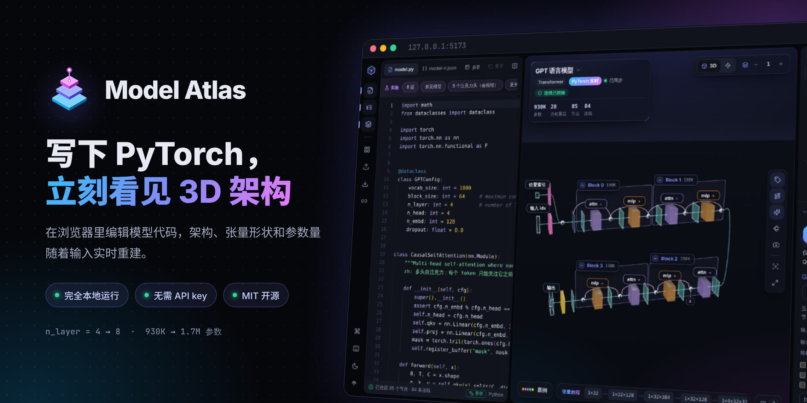

<p align="center"></p>

# Model Atlas · 3D 模型架构实验室

[English](README.md) | **简体中文**

在浏览器里**编写 PyTorch 代码，实时看到它的 3D 架构**。改一行代码（层数、通道、步幅、注意力头数……），3D 结构、张量形状、参数量会立即随之重建；代码写错时会指出出错的那一行。界面支持中文和英文。


演示视频（43 秒，MP4）：[docs/media/demo.mp4](docs/media/demo.mp4)

**完全在本机运行**：3D 化由浏览器里自带的小型 Python 解释器完成。它只推算张量形状，不做真实计算，所以不联网、不需要任何 API key、不需要安装 Python 或 PyTorch，代码也不会上传。项目和笔记只存在你自己的浏览器里，也可以导出成文件。

## 运行 / Run

```bash
npm install      # 第一次运行时需要
npm run dev
```

打开终端里显示的地址（默认 http://127.0.0.1:5173）。Windows 上也可以直接双击 `start-3d-model.bat`，第一次运行时它会自动执行 `npm install`。需要 Node.js 22.6 或更新版本（推荐当前的 22 LTS）。

| 命令 | 作用 |
| --- | --- |
| `npm run build` | 类型检查并生成生产版本 |
| `npm test` | 运行下面全部四组测试 |
| `npm run test:interpreter` | 解释器测试：38 个常见 PyTorch 写法，参数量和打印结果与真实 PyTorch 对照 |
| `npm run test:training` | 训练流程追踪和导入模板的测试 |
| `npm run test:study` / `npm run test:gestures` | 学习工具、手势状态机测试 |
| `npm run check:graphs` | 检查每个内置模型的接口、形状、重叠和连线穿模 |
| `npm run trace -- model.py train.py` | 在命令行追踪一组文件，打印运行顺序、顶层模块、形状和参数量 |
| `npm run verify:torch` | 可选：本机装了 PyTorch 时，用真实 PyTorch 逐个核对内置模型和解释器测试（见下文） |

## 界面

- **左侧：代码**。`model.py` 是真实的 PyTorch 代码。上方的“实验”按钮会自动修改代码（例如把 GPT 改成 8 层、让 U-Net 输入变成奇数尺寸），用来观察结构如何变化或报错。“参数表”标签是类似 torchinfo 的逐层表格。光标停在某一行时，会自动选中对应的层。
- **中间：3D / 结构图**。层的大小由它输出的张量形状决定（通道越多越厚、分辨率越高越大），残差连接从上方弧线绕过，跳连（如 U-Net 的 concat）从下方绕过，粒子沿连线流动表示数据方向。
  - **层级**：控制嵌套模块展开几层；“自动”会挑一个清晰的层级。双击实心模块可单独展开，单击模块标签选中、双击标签收起。
  - **追踪**：选中节点时淡化其他部分，只突出它的直接输入输出。
  - **张量旅程**：底部显示主路径上张量形状的每一次变化，点击即可定位。
  - **结构图**：同一张图的平面版本，自动换行，可拖动和滚轮缩放。
  - **手势控制**：摄像头图标开启，说明见下文。
- **右侧：模型树 + 模块检查器**。树的展开状态和 3D 视图同步；检查器显示参数量及占比、输入/输出形状（变化的维度会高亮）、配置、学习笔记与公式、子模块，以及“定义于 / forward 中调用”两个跳转到代码的链接。
- **顶栏**：点击模型名打开**模型库**；也可以导入 `.py` 或 JSON、导出 JSON、切换中英文。

## 可编辑的代码模型

| 模型 | 说明 | 参数量 |
| --- | --- | --- |
| MLP | MNIST 全连接网络 | 535,818 |
| LeNet-5 | 经典卷积网络 | 约 62K |
| ResNet-18 | BasicBlock + 投影捷径（CIFAR 版） | 11,173,962 |
| GPT (nanoGPT) | 因果自注意力，显式写出 QKᵀ、掩码、softmax | 929,536 |
| Vision Transformer | patch 嵌入 + [CLS] + nn.MultiheadAttention | 2,693,578 |
| U-Net | 由 `WIDTHS` 列表决定层数的编码器-解码器 | 约 1.93M |
| DiT | adaLN-Zero 调制的扩散 Transformer | 约 11.0M |
| Conv VAE | μ / log σ² 与重参数化 | 约 1.13M |
| BiLSTM | 双向 LSTM 文本分类 | 3,008,514 |
| 导入模板 · CNN + 训练循环 | `templates/atlas-template`，画出一个完整训练步 | 94,762 |
| GPT · 训练循环 | 同一个 GPT，加上 nanoGPT 风格的 `train.py` | 929,536 |

另有 DDPM、DDIM、CFG、Latent Diffusion、Flow Matching、π0、π0.5、Video DiT、因果视频生成，以及异常检测模型 UniADet、VisualAD 等代码模型，可在模型库里打开。参数量与真实 PyTorch 一致。

## 导入你自己的项目

1. 点 **导入模型**，选择几个 `.py` 文件或整个文件夹。文件只在浏览器里读取。
2. 在列表里勾选要包含的文件，再选从哪个文件开始运行，和 `python 入口文件.py` 的效果一样：
   - 选 `model.py`：只画网络本身；
   - 选 `train.py`：画出一个完整的训练步。
3. 对话框会先试着追踪一遍，告诉你能否成功、有多少参数；有错误时会指出出错的文件和行号。

固定模板在 [templates/](templates/)：

| 文件 | 必需 | 内容 |
| --- | --- | --- |
| `model.py` | ✓ | 网络，示例调用写在 `if __name__ == "__main__":` 里 |
| `data.py` |  | 用假张量描述一个样本的 `Dataset`，以及 `DataLoader` |
| `train.py` |  | 损失、优化器、学习率调度、训练循环 |
| `atlas.json` |  | 名称、说明、入口文件 `entry` |

**让 AI 帮你改写**：自己的代码用了解释器不支持的写法（第三方库、读取真实文件等）时，在导入对话框里点 **复制 AI 提示词**，内容同 [templates/ai-import-prompt.md](templates/ai-import-prompt.md)。把它连同你的代码发给常用的 AI 助手，它会按模板输出上面这几个文件，再导入即可。Atlas 本身不调用任何 AI 或 API。

### 训练流程也能 3D 化

包含 `train.py` 时，会画出一个训练步：

批数据 → 模型 → 损失 → `loss.backward()` → 梯度裁剪 → `optimizer.step()`

- **循环只跑一次**：外层的 epoch 和 batch 循环各跑一次，“更新参数”模块会写明真实训练要重复多少步，例如 `20 × 781 = 15,620 步`。
- **可以编辑**：优化器的学习率、weight decay、学习率调度器都显示在配置里；改代码后图会立即重建。
- **支持的写法**：
  - `torch.optim` 的常用优化器和 `lr_scheduler`；
  - `Dataset`、`TensorDataset`、`DataLoader`、`random_split`；
  - `autocast`、`GradScaler`；
  - `clip_grad_norm_`；
  - `tqdm`。

### 代码引擎如何工作

`src/core/pytorch/` 是一个运行在浏览器里的小型 Python 解释器（词法分析 → 语法分析 → 执行）。张量只携带形状，不做真实计算，所以即使是千万参数的模型也能在几毫秒内重建。执行模型时会记录一张计算图：你写的 `nn.Module` 类成为可折叠的分组，`nn.Linear`、`nn.Conv2d` 等层成为叶子节点，`+`、`@`、`torch.cat`、`softmax` 等成为运算节点。加法中与输入同形状的捷径会被标记为残差边，拼接中的早期特征会被标记为跳连。

支持的内容：类、函数、循环、推导式、`dataclass`、`nn.Sequential / ModuleList / ModuleDict`、常见的 `nn` 层（线性、卷积/转置卷积 1–3D、各类归一化、嵌入、池化、上采样、Dropout、激活、MultiheadAttention、Transformer 层、LSTM/GRU/RNN 等）、`nn.TransformerEncoder / Decoder / Transformer`、损失函数层、`ParameterList / ParameterDict`、`torch` / `F` 的常见张量函数（含 `gather`、`scatter`、`topk`、`meshgrid`、`outer`、高级索引等）、`einops`（含 `Rearrange` 层）与带 `...` 的 `torch.einsum`、f-string 与 `str.format`、海象运算符 `:=`。只有张量运算、没有调用任何 `nn.Module` 的脚本，会按运算逐步画出来。不支持的写法（例如自定义 CUDA 算子或依赖真实数值的控制流）会给出带行号的提示，3D 视图保留上一次成功的结构。

```text
model.py → lexer → parser → interpreter (shape-only tensors) → trace → Model IR
                                                                    ↓
                       view graph (collapse depth, ranks, lanes, row wrapping)
                                                                    ↓
                                     3D scene · diagram · tree · inspector
```

## 我的项目（自动保存）

- 导入的项目、新建的空白模型、改过代码的内置模型，都会自动保存在**这个浏览器**里，各存一份，互不覆盖。
- 打开模型库，最上面的“我的项目”列出它们，点一下就能回到上次的代码；垃圾桶按钮可以把某个项目从浏览器里删掉（会先确认）。
- 改过的内置模型在库里标着“已修改”，再打开时是你改过的版本；代码栏的“重置”会在确认后恢复原始代码。
- 数据只在本机浏览器中。换浏览器或清除网站数据前，请用顶栏的“导出 JSON”留一份。浏览器存储满了时，切换模型前会提示。

## 学习图谱

| 分组 | 图谱 |
| --- | --- |
| π 系列 | π0、π0.5、π 系列演进（π0 → π0.5 → π0.7） |
| 扩散模型 | DDPM、DDIM 采样、无分类器引导（CFG）、Latent Diffusion + VAE、扩散 U-Net、DiT、Flow Matching |
| 视频 | 3D VAE、视频生成流水线、因果视频生成 |

- 学习图谱是手绘的概念图，不是由代码追踪出来的，所以代码栏里显示的是它的 Model IR JSON。大多数图谱在库里都有对应的“可运行代码”版本。
- DDIM、CFG、Flow Matching 画的是方法流程，不是独立的网络结构。π0.7 节点只概括公开能力，不代表未公开的逐层设计。因果视频图示意的是分块续写和只看过去的注意力，不对应某一个具体实现。
- 实线表示数据流；虚线表示条件、训练关系、复用训练好的网络和反馈。各图的论文出处和连线依据记录在 [ARCHITECTURE_SOURCES.md](ARCHITECTURE_SOURCES.md)。
- 3D VAE 保留了原来的可编辑练习：把 `blocks.py` 里的 `stride=2` 改成 `stride=(1,2,2)`，可以看到时间轴不再被压缩。

主要参考：[π0](https://arxiv.org/abs/2410.24164)、[π0.5](https://arxiv.org/abs/2504.16054)、[π0.7](https://www.pi.website/blog/pi07)、[DDPM](https://arxiv.org/abs/2006.11239)、[DDIM](https://arxiv.org/abs/2010.02502)、[CFG](https://arxiv.org/abs/2207.12598)、[Latent Diffusion](https://arxiv.org/abs/2112.10752)、[U-Net](https://arxiv.org/abs/1505.04597)、[DiT](https://arxiv.org/abs/2212.09748)、[Flow Matching](https://arxiv.org/abs/2210.02747)、[Open-Sora 2.0](https://arxiv.org/abs/2503.09642)、[CausVid](https://arxiv.org/abs/2412.07772)。

## 导入 Model IR JSON

除了 `.py` 文件，也可以导入一个描述结构的 JSON，例如 [examples/mini-transformer.json](examples/mini-transformer.json)（其中也演示了中文文本）。可以是单独的 Model IR，也可以是 Atlas 项目包：

```json
{
  "id": "my-model",
  "name": "My Model",
  "nodes": [
    { "id": "input", "name": "Input", "type": "tensor", "outputShape": ["B", 3, 16, 256, 256] },
    { "id": "block", "name": "Block", "type": "generic", "inputShape": ["B", 3, 16, 256, 256] }
  ],
  "edges": [{ "id": "input-block", "source": "input", "target": "block" }]
}
```

- 节点还可以写 `parentId`、`description`、`parameters`、`learning`、`source`、`visualization.position`；连线可以写 `type` 和可选的 `via` 拐点。没写位置的节点会自动排布。
- 翻译文本放在 `localized.zh` 或 `localized.en` 里，字段为 `name`、`description` 和可选的 `learning`。
- 项目包的格式是 `{ "format": "model-atlas", "version": 2, "model": { ... }, "codeFiles": { "model.py": "..." } }`。
- 导入前会检查 id、节点类型、形状、连线、父子环、位置和文件大小。顶栏的“导出 JSON”会保存当前模型和代码，可以再导入。

## 用真实 PyTorch 核对（可选）

Atlas 本身不需要 Python。如果你的电脑上装了 PyTorch（`pip install torch`），可以运行：

```bash
npm run verify:torch                 # 核对 20 个内置模型和解释器测试
npm run verify:torch -- --update     # 新增测试用例后，用 PyTorch 重新生成 tests/interpreter/expected.json
```

它会用真实 PyTorch 运行每个内置模型（训练脚本在第一次 `optimizer.step()` 时停下），比较参数量、模型和每个直接子模块的输出形状，以及解释器测试的打印结果。可以用环境变量 `PYTHON` 指定 Python。没装 PyTorch 时会直接跳过，不联网下载任何东西。

## 手势控制

- 手势识别使用 MediaPipe Hand Landmarker，在 Web Worker 里运行。模型和 WebAssembly 文件放在 `public/mediapipe`，从本机加载；摄像头画面只在浏览器里处理，不会上传。
- 需要浏览器支持 `getUserMedia`、`createImageBitmap` 和 Web Worker，并在 `localhost` 或其他安全来源下打开。
- `npm run test:gestures` 检查手势状态机。手势阈值是初始默认值，实际使用时可能需要按摄像头、光线和手的大小调整。

## 参与贡献

欢迎提交 issue 和 PR，流程和本地检查命令见 [CONTRIBUTING.md](CONTRIBUTING.md)。参与时请遵守[行为准则](CODE_OF_CONDUCT.md)；安全问题请按 [SECURITY.md](SECURITY.md) 私下报告。

## 许可

本项目以 [MIT 许可](LICENSE) 发布。`public/mediapipe` 中的 MediaPipe 文件以 Apache-2.0 许可分发，第三方组件的说明见 [THIRD_PARTY_NOTICES.md](THIRD_PARTY_NOTICES.md)。
